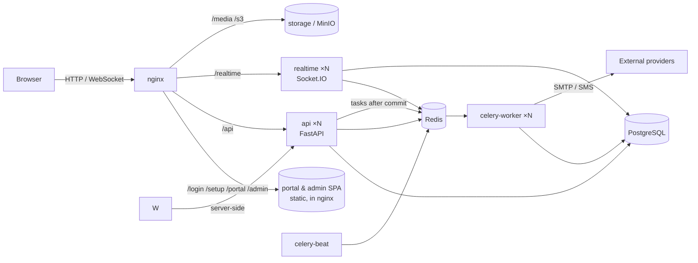

# Architecture

## Backend (modular monolith)
- `app/core` — configuration (infrastructure only), generated secrets, database, Redis, permissions
  catalogue, request dependencies (principal, permission/module guards), settings store with cache, metrics.
- `app/models` — SQLAlchemy models; schema changes only through Alembic migrations.
- `app/modules/*` — feature routers (auth, setup, admin users/roles/audit/media/health/dashboard,
  configuration, public). Each later module (alumni, community, jobs, mentorship, events, donations, CMS…)
  is added as its own package with router, service and schemas.
- `app/services` — integrations (encrypted credentials), messaging (SMTP, generic HTTP SMS, templates,
  delivery log), storage (local / S3-compatible), media processing.
- `app/realtime.py` — Socket.IO gateway; identity only from a verified access token; `user:{id}` rooms;
  Redis manager for cross-replica broadcasts; WebSocket transport (no sticky sessions needed).
- `app/worker.py`, `app/tasks.py` — Celery; delivery rows act as a transactional outbox (dispatched after
  commit, re-dispatched by a sweep, idempotent consumers, retries with back-off).

## Security model
- Access token (15 min JWT, in memory in the browser) + refresh token (httpOnly, SameSite=Strict cookie
  scoped to `/api/v1/auth`, rotated on every use; reuse of a rotated token ends all sessions).
- Sessions stored server-side (revocable: logout, logout-all, password change, admin sign-out).
- Argon2id password hashing; lockout after N failures (≥3, configurable); optional/required TOTP 2FA with
  recovery codes; email verification and SMS OTP.
- RBAC enforced in the API for every endpoint (`require("module.action")`); admins cannot grant permissions
  they lack; the last Super Administrator is protected.
- Integration credentials Fernet-encrypted at rest, masked in responses; uploads type-sniffed, size-limited,
  images re-encoded (metadata stripped); SVG/executables refused; CSV exports neutralise formula injection.
- Audit log for administrative and security-relevant actions.

## Performance
- Settings, branding, module switches, flags, storage backend and the public site payload are cached
  in-process and invalidated across replicas through a Redis version counter.
- Authenticated principals are cached per session for 5 s (revocations apply within 5 s).
- Role permissions are never loaded implicitly; list endpoints use bounded pages.
- `Server-Timing` on every response, latency percentiles in System Health, Prometheus `/metrics`.
