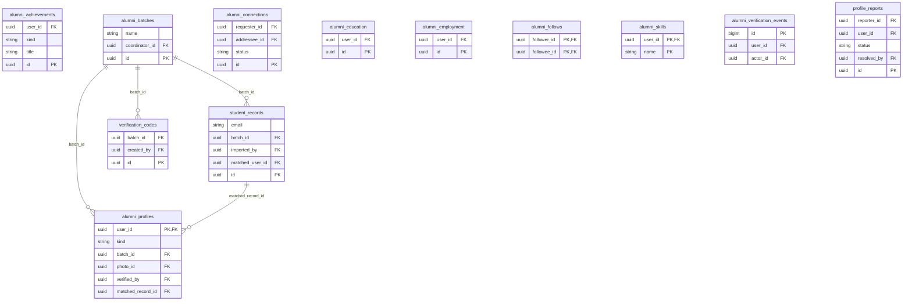
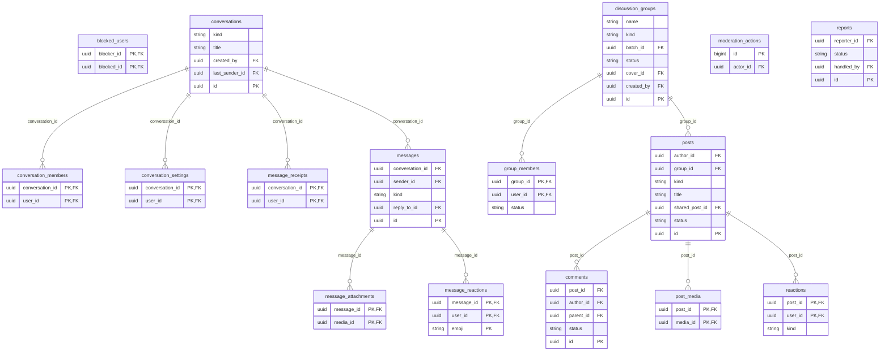
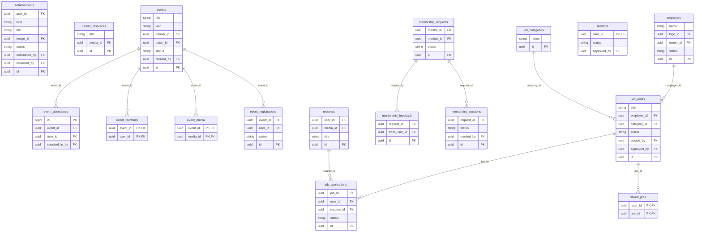
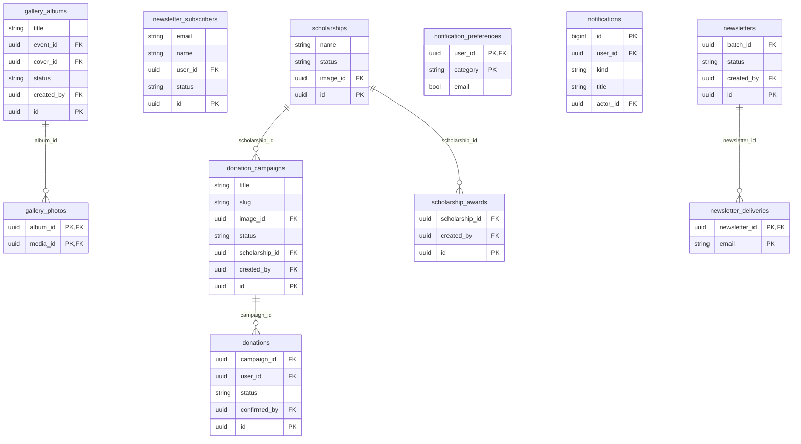
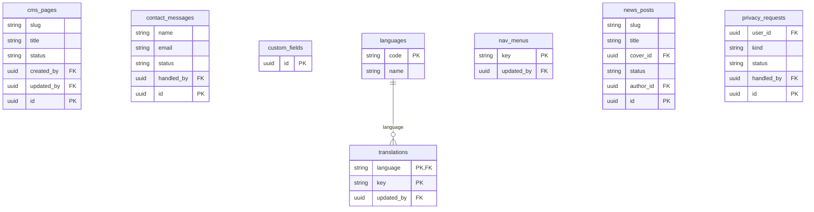

# Database ERD

Generated from the SQLAlchemy models by `backend/scripts/gen_erd.py` — do not edit by hand.
81 tables in PostgreSQL. Diagrams show keys and relations; the reference lists every column.

## Identity, access and configuration

```mermaid
erDiagram
  audit_logs {
    bigint id PK
    uuid actor_id FK
  }
  branding_settings {
    int id PK
    uuid updated_by FK
  }
  feature_flags {
    string key PK
    string name
  }
  integration_settings {
    string kind PK
    uuid updated_by FK
  }
  login_attempts {
    bigint id PK
    string email
  }
  media_library {
    uuid uploaded_by FK
    uuid id PK
  }
  message_templates {
    string name
    uuid id PK
  }
  module_settings {
    string key PK
    uuid updated_by FK
  }
  notification_logs {
    bigint id PK
    string status
  }
  permissions {
    uuid id PK
  }
  role_permissions {
    uuid role_id PK,FK
    uuid permission_id PK,FK
  }
  roles {
    string name
    uuid id PK
  }
  sessions {
    uuid user_id FK
    uuid id PK
  }
  system_settings {
    string key PK
    uuid updated_by FK
  }
  user_roles {
    uuid user_id PK,FK
    uuid role_id PK,FK
  }
  user_verifications {
    uuid user_id FK
    string kind
    uuid id PK
  }
  users {
    string email
    string status
    uuid id PK
  }
  users ||--o{ audit_logs : "actor_id"
  users ||--o{ branding_settings : "updated_by"
  users ||--o{ integration_settings : "updated_by"
  users ||--o{ media_library : "uploaded_by"
  users ||--o{ module_settings : "updated_by"
  permissions ||--o{ role_permissions : "permission_id"
  roles ||--o{ role_permissions : "role_id"
  users ||--o{ sessions : "user_id"
  users ||--o{ system_settings : "updated_by"
  roles ||--o{ user_roles : "role_id"
  users ||--o{ user_roles : "user_id"
  users ||--o{ user_verifications : "user_id"
```

## Alumni core

## Community and messaging

## Events, careers, mentorship, achievements

## Institutional support

## Administration and privacy

## Column reference

### achievements

| Column | Type | Null | Key / reference |
|---|---|---|---|
| user_id | uuid | no | → users.id |
| kind | string | no |  |
| title | string | no |  |
| summary | string | no |  |
| story | text | no |  |
| image_id | uuid | yes | → media_library.id |
| year | int | yes |  |
| month | int | yes |  |
| status | string | no |  |
| featured | bool | no |  |
| public_consent | bool | yes |  |
| nominated_by | uuid | yes | → users.id |
| nomination_reason | string | yes |  |
| reviewed_by | uuid | yes | → users.id |
| rejection_reason | string | yes |  |
| published_at | timestamptz | yes |  |
| id | uuid | no | PK |
| created_at | timestamptz | no |  |
| updated_at | timestamptz | no |  |

### alumni_achievements

| Column | Type | Null | Key / reference |
|---|---|---|---|
| user_id | uuid | no | → users.id |
| kind | string | no |  |
| title | string | no |  |
| issuer | string | yes |  |
| year | int | yes |  |
| url | string | yes |  |
| description | string | yes |  |
| id | uuid | no | PK |
| created_at | timestamptz | no |  |
| updated_at | timestamptz | no |  |

### alumni_batches

| Column | Type | Null | Key / reference |
|---|---|---|---|
| name | string | no |  |
| graduation_year | int | no |  |
| admission_year | int | yes |  |
| description | string | no |  |
| coordinator_id | uuid | yes | → users.id |
| is_active | bool | no |  |
| id | uuid | no | PK |
| created_at | timestamptz | no |  |
| updated_at | timestamptz | no |  |

### alumni_connections

| Column | Type | Null | Key / reference |
|---|---|---|---|
| requester_id | uuid | no | → users.id |
| addressee_id | uuid | no | → users.id |
| status | string | no |  |
| message | string | yes |  |
| created_at | timestamptz | no |  |
| responded_at | timestamptz | yes |  |
| id | uuid | no | PK |

### alumni_education

| Column | Type | Null | Key / reference |
|---|---|---|---|
| user_id | uuid | no | → users.id |
| institution | string | no |  |
| qualification | string | no |  |
| field_of_study | string | yes |  |
| start_year | int | yes |  |
| end_year | int | yes |  |
| is_sst | bool | no |  |
| description | string | yes |  |
| id | uuid | no | PK |
| created_at | timestamptz | no |  |
| updated_at | timestamptz | no |  |

### alumni_employment

| Column | Type | Null | Key / reference |
|---|---|---|---|
| user_id | uuid | no | → users.id |
| organization | string | no |  |
| designation | string | no |  |
| industry | string | yes |  |
| location | string | yes |  |
| start_date | date | yes |  |
| end_date | date | yes |  |
| is_current | bool | no |  |
| description | string | yes |  |
| id | uuid | no | PK |
| created_at | timestamptz | no |  |
| updated_at | timestamptz | no |  |

### alumni_follows

| Column | Type | Null | Key / reference |
|---|---|---|---|
| follower_id | uuid | no | PK → users.id |
| followee_id | uuid | no | PK → users.id |
| created_at | timestamptz | no |  |

### alumni_profiles

| Column | Type | Null | Key / reference |
|---|---|---|---|
| user_id | uuid | no | PK → users.id |
| kind | string | no |  |
| gender | string | yes |  |
| date_of_birth | date | yes |  |
| admission_year | int | yes |  |
| graduation_year | int | yes |  |
| batch_id | uuid | yes | → alumni_batches.id |
| class_name | string | yes |  |
| registration_no | string | yes |  |
| reg_norm | string | yes |  |
| city | string | yes |  |
| country | string | yes |  |
| designation | string | yes |  |
| organization | string | yes |  |
| industry | string | yes |  |
| bio | text | yes |  |
| photo_id | uuid | yes | → media_library.id |
| website | string | yes |  |
| linkedin | string | yes |  |
| visibility | string | no |  |
| privacy | jsonb | no |  |
| verification_status | string | no |  |
| verification_method | string | yes |  |
| verified_at | timestamptz | yes |  |
| verified_by | uuid | yes | → users.id |
| verification_note | string | yes |  |
| rejection_reason | string | yes |  |
| submitted_at | timestamptz | yes |  |
| evidence_ids | jsonb | no |  |
| matched_record_id | uuid | yes | → student_records.id |
| match_strength | string | yes |  |
| completion | int | no |  |
| search | tsvector | yes |  |
| custom_fields | jsonb | no |  |
| created_at | timestamptz | no |  |
| updated_at | timestamptz | no |  |

### alumni_skills

| Column | Type | Null | Key / reference |
|---|---|---|---|
| user_id | uuid | no | PK → users.id |
| name | string | no | PK |
| position | int | no |  |

### alumni_verification_events

| Column | Type | Null | Key / reference |
|---|---|---|---|
| id | bigint | no | PK |
| user_id | uuid | no | → users.id |
| action | string | no |  |
| method | string | yes |  |
| note | string | yes |  |
| actor_id | uuid | yes | → users.id |
| created_at | timestamptz | no |  |

### audit_logs

| Column | Type | Null | Key / reference |
|---|---|---|---|
| id | bigint | no | PK |
| actor_id | uuid | yes | → users.id |
| action | string | no |  |
| entity | string | no |  |
| entity_id | string | yes |  |
| summary | string | no |  |
| data | jsonb | yes |  |
| ip | inet | yes |  |
| created_at | timestamptz | no |  |

### blocked_users

| Column | Type | Null | Key / reference |
|---|---|---|---|
| blocker_id | uuid | no | PK → users.id |
| blocked_id | uuid | no | PK → users.id |
| created_at | timestamptz | no |  |

### branding_settings

| Column | Type | Null | Key / reference |
|---|---|---|---|
| id | int | no | PK |
| draft | jsonb | no |  |
| published | jsonb | no |  |
| version | int | no |  |
| published_at | timestamptz | yes |  |
| updated_at | timestamptz | no |  |
| updated_by | uuid | yes | → users.id |

### career_resources

| Column | Type | Null | Key / reference |
|---|---|---|---|
| title | string | no |  |
| category | string | no |  |
| description | string | no |  |
| url | string | yes |  |
| media_id | uuid | yes | → media_library.id |
| published | bool | no |  |
| position | int | no |  |
| id | uuid | no | PK |
| created_at | timestamptz | no |  |
| updated_at | timestamptz | no |  |

### cms_pages

| Column | Type | Null | Key / reference |
|---|---|---|---|
| slug | string | no |  |
| title | string | no |  |
| status | string | no |  |
| draft | jsonb | no |  |
| published | jsonb | yes |  |
| has_unpublished_changes | bool | no |  |
| publish_at | timestamptz | yes |  |
| published_at | timestamptz | yes |  |
| created_by | uuid | yes | → users.id |
| updated_by | uuid | yes | → users.id |
| deleted_at | timestamptz | yes |  |
| id | uuid | no | PK |
| created_at | timestamptz | no |  |
| updated_at | timestamptz | no |  |

### comments

| Column | Type | Null | Key / reference |
|---|---|---|---|
| post_id | uuid | no | → posts.id |
| author_id | uuid | no | → users.id |
| parent_id | uuid | yes | → comments.id |
| body | text | no |  |
| status | string | no |  |
| edited_at | timestamptz | yes |  |
| created_at | timestamptz | no |  |
| id | uuid | no | PK |

### contact_messages

| Column | Type | Null | Key / reference |
|---|---|---|---|
| name | string | no |  |
| email | string | no |  |
| phone | string | yes |  |
| subject | string | no |  |
| message | text | no |  |
| status | string | no |  |
| ip | string | yes |  |
| handled_by | uuid | yes | → users.id |
| created_at | timestamptz | no |  |
| id | uuid | no | PK |

### conversation_members

| Column | Type | Null | Key / reference |
|---|---|---|---|
| conversation_id | uuid | no | PK → conversations.id |
| user_id | uuid | no | PK → users.id |
| role | string | no |  |
| joined_at | timestamptz | no |  |
| left_at | timestamptz | yes |  |

### conversation_settings

| Column | Type | Null | Key / reference |
|---|---|---|---|
| conversation_id | uuid | no | PK → conversations.id |
| user_id | uuid | no | PK → users.id |
| muted | bool | no |  |
| archived | bool | no |  |
| pinned | bool | no |  |

### conversations

| Column | Type | Null | Key / reference |
|---|---|---|---|
| kind | string | no |  |
| title | string | yes |  |
| direct_key | string | yes |  |
| created_by | uuid | yes | → users.id |
| created_at | timestamptz | no |  |
| last_message_at | timestamptz | yes |  |
| last_message_preview | string | yes |  |
| last_sender_id | uuid | yes | → users.id |
| id | uuid | no | PK |

### custom_fields

| Column | Type | Null | Key / reference |
|---|---|---|---|
| entity | string | no |  |
| key | string | no |  |
| label | string | no |  |
| labels | jsonb | no |  |
| help_text | string | no |  |
| field_type | string | no |  |
| options | jsonb | no |  |
| required | bool | no |  |
| visibility | string | no |  |
| validation | jsonb | no |  |
| condition | jsonb | yes |  |
| on_registration | bool | no |  |
| position | int | no |  |
| active | bool | no |  |
| id | uuid | no | PK |
| created_at | timestamptz | no |  |
| updated_at | timestamptz | no |  |

### discussion_groups

| Column | Type | Null | Key / reference |
|---|---|---|---|
| name | string | no |  |
| description | string | no |  |
| kind | string | no |  |
| batch_id | uuid | yes | → alumni_batches.id |
| join_policy | string | no |  |
| status | string | no |  |
| cover_id | uuid | yes | → media_library.id |
| created_by | uuid | yes | → users.id |
| member_count | int | no |  |
| post_count | int | no |  |
| last_post_at | timestamptz | yes |  |
| id | uuid | no | PK |
| created_at | timestamptz | no |  |
| updated_at | timestamptz | no |  |

### donation_campaigns

| Column | Type | Null | Key / reference |
|---|---|---|---|
| title | string | no |  |
| slug | string | no |  |
| category | string | no |  |
| summary | string | no |  |
| description | text | no |  |
| image_id | uuid | yes | → media_library.id |
| goal_amount | numeric | yes |  |
| currency | string | no |  |
| starts_on | date | yes |  |
| ends_on | date | yes |  |
| status | string | no |  |
| scholarship_id | uuid | yes | → scholarships.id |
| raised_amount | numeric | no |  |
| donor_count | int | no |  |
| created_by | uuid | yes | → users.id |
| id | uuid | no | PK |
| created_at | timestamptz | no |  |
| updated_at | timestamptz | no |  |

### donations

| Column | Type | Null | Key / reference |
|---|---|---|---|
| campaign_id | uuid | yes | → donation_campaigns.id |
| user_id | uuid | yes | → users.id |
| donor_name | string | no |  |
| donor_email | string | yes |  |
| amount | numeric | no |  |
| currency | string | no |  |
| category | string | no |  |
| method | string | no |  |
| status | string | no |  |
| anonymous | bool | no |  |
| recognition_consent | bool | no |  |
| message | string | yes |  |
| reference | string | no |  |
| payment_reference | string | yes |  |
| receipt_no | string | yes |  |
| confirmed_at | timestamptz | yes |  |
| confirmed_by | uuid | yes | → users.id |
| notes | string | yes |  |
| custom_fields | jsonb | no |  |
| id | uuid | no | PK |
| created_at | timestamptz | no |  |
| updated_at | timestamptz | no |  |

### employers

| Column | Type | Null | Key / reference |
|---|---|---|---|
| name | string | no |  |
| website | string | yes |  |
| industry | string | yes |  |
| description | string | no |  |
| logo_id | uuid | yes | → media_library.id |
| owner_id | uuid | yes | → users.id |
| status | string | no |  |
| rejection_reason | string | yes |  |
| id | uuid | no | PK |
| created_at | timestamptz | no |  |
| updated_at | timestamptz | no |  |

### event_attendance

| Column | Type | Null | Key / reference |
|---|---|---|---|
| id | bigint | no | PK |
| event_id | uuid | no | → events.id |
| user_id | uuid | no | → users.id |
| method | string | no |  |
| checked_in_by | uuid | yes | → users.id |
| checked_in_at | timestamptz | no |  |

### event_feedback

| Column | Type | Null | Key / reference |
|---|---|---|---|
| event_id | uuid | no | PK → events.id |
| user_id | uuid | no | PK → users.id |
| rating | int | no |  |
| comment | string | yes |  |
| created_at | timestamptz | no |  |

### event_media

| Column | Type | Null | Key / reference |
|---|---|---|---|
| event_id | uuid | no | PK → events.id |
| media_id | uuid | no | PK → media_library.id |
| position | int | no |  |
| created_at | timestamptz | no |  |

### event_registrations

| Column | Type | Null | Key / reference |
|---|---|---|---|
| event_id | uuid | no | → events.id |
| user_id | uuid | no | → users.id |
| status | string | no |  |
| guests | int | no |  |
| checkin_code | string | no |  |
| note | string | yes |  |
| created_at | timestamptz | no |  |
| updated_at | timestamptz | no |  |
| id | uuid | no | PK |

### events

| Column | Type | Null | Key / reference |
|---|---|---|---|
| title | string | no |  |
| kind | string | no |  |
| summary | string | no |  |
| description | text | no |  |
| banner_id | uuid | yes | → media_library.id |
| starts_at | timestamptz | no |  |
| ends_at | timestamptz | no |  |
| venue | string | yes |  |
| address | string | yes |  |
| is_online | bool | no |  |
| online_url | string | yes |  |
| capacity | int | yes |  |
| max_guests | int | no |  |
| registration_deadline | timestamptz | yes |  |
| batch_id | uuid | yes | → alumni_batches.id |
| status | string | no |  |
| cancel_reason | string | yes |  |
| reminder_sent_at | timestamptz | yes |  |
| created_by | uuid | yes | → users.id |
| registered_count | int | no |  |
| custom_fields | jsonb | no |  |
| id | uuid | no | PK |
| created_at | timestamptz | no |  |
| updated_at | timestamptz | no |  |

### feature_flags

| Column | Type | Null | Key / reference |
|---|---|---|---|
| key | string | no | PK |
| name | string | no |  |
| description | string | no |  |
| enabled | bool | no |  |
| roles | array | no |  |
| updated_at | timestamptz | no |  |

### gallery_albums

| Column | Type | Null | Key / reference |
|---|---|---|---|
| title | string | no |  |
| description | string | no |  |
| event_id | uuid | yes | → events.id |
| cover_id | uuid | yes | → media_library.id |
| taken_on | date | yes |  |
| visibility | string | no |  |
| status | string | no |  |
| photo_count | int | no |  |
| created_by | uuid | yes | → users.id |
| published_at | timestamptz | yes |  |
| id | uuid | no | PK |
| created_at | timestamptz | no |  |
| updated_at | timestamptz | no |  |

### gallery_photos

| Column | Type | Null | Key / reference |
|---|---|---|---|
| album_id | uuid | no | PK → gallery_albums.id |
| media_id | uuid | no | PK → media_library.id |
| caption | string | no |  |
| position | int | no |  |
| created_at | timestamptz | no |  |

### group_members

| Column | Type | Null | Key / reference |
|---|---|---|---|
| group_id | uuid | no | PK → discussion_groups.id |
| user_id | uuid | no | PK → users.id |
| role | string | no |  |
| status | string | no |  |
| joined_at | timestamptz | no |  |

### integration_settings

| Column | Type | Null | Key / reference |
|---|---|---|---|
| kind | string | no | PK |
| provider | string | no |  |
| config | jsonb | no |  |
| secrets_enc | text | yes |  |
| enabled | bool | no |  |
| last_tested_at | timestamptz | yes |  |
| last_test_ok | bool | yes |  |
| last_test_message | string | yes |  |
| updated_at | timestamptz | no |  |
| updated_by | uuid | yes | → users.id |

### job_applications

| Column | Type | Null | Key / reference |
|---|---|---|---|
| job_id | uuid | no | → job_posts.id |
| user_id | uuid | no | → users.id |
| resume_id | uuid | yes | → resumes.id |
| cover_letter | text | yes |  |
| status | string | no |  |
| poster_note | string | yes |  |
| id | uuid | no | PK |
| created_at | timestamptz | no |  |
| updated_at | timestamptz | no |  |

### job_categories

| Column | Type | Null | Key / reference |
|---|---|---|---|
| name | string | no |  |
| position | int | no |  |
| id | uuid | no | PK |

### job_posts

| Column | Type | Null | Key / reference |
|---|---|---|---|
| title | string | no |  |
| organization | string | no |  |
| employer_id | uuid | yes | → employers.id |
| category_id | uuid | yes | → job_categories.id |
| employment_type | string | no |  |
| location | string | no |  |
| remote | bool | no |  |
| salary_min | int | yes |  |
| salary_max | int | yes |  |
| salary_currency | string | yes |  |
| experience | string | yes |  |
| skills | jsonb | no |  |
| description | text | no |  |
| deadline | date | yes |  |
| apply_url | string | yes |  |
| apply_email | string | yes |  |
| apply_in_portal | bool | no |  |
| is_referral | bool | no |  |
| status | string | no |  |
| rejection_reason | string | yes |  |
| posted_by | uuid | yes | → users.id |
| approved_by | uuid | yes | → users.id |
| approved_at | timestamptz | yes |  |
| views | int | no |  |
| custom_fields | jsonb | no |  |
| id | uuid | no | PK |
| created_at | timestamptz | no |  |
| updated_at | timestamptz | no |  |

### languages

| Column | Type | Null | Key / reference |
|---|---|---|---|
| code | string | no | PK |
| name | string | no |  |
| native_name | string | no |  |
| rtl | bool | no |  |
| enabled | bool | no |  |
| position | int | no |  |

### login_attempts

| Column | Type | Null | Key / reference |
|---|---|---|---|
| id | bigint | no | PK |
| email | string | no |  |
| ip | inet | yes |  |
| success | bool | no |  |
| reason | string | yes |  |
| created_at | timestamptz | no |  |

### media_library

| Column | Type | Null | Key / reference |
|---|---|---|---|
| storage | string | no |  |
| key | string | no |  |
| filename | string | no |  |
| mime | string | no |  |
| size | bigint | no |  |
| width | int | yes |  |
| height | int | yes |  |
| variants | jsonb | no |  |
| alt | string | no |  |
| folder | string | no |  |
| private | bool | no |  |
| uploaded_by | uuid | yes | → users.id |
| created_at | timestamptz | no |  |
| id | uuid | no | PK |
| deleted_at | timestamptz | yes |  |

### mentors

| Column | Type | Null | Key / reference |
|---|---|---|---|
| user_id | uuid | no | PK → users.id |
| status | string | no |  |
| industry | string | yes |  |
| expertise | jsonb | no |  |
| skills | jsonb | no |  |
| experience_years | int | yes |  |
| hours_per_month | int | no |  |
| formats | jsonb | no |  |
| mentees_students | bool | no |  |
| mentees_alumni | bool | no |  |
| max_mentees | int | no |  |
| introduction | text | no |  |
| rejection_reason | string | yes |  |
| approved_by | uuid | yes | → users.id |
| approved_at | timestamptz | yes |  |
| custom_fields | jsonb | no |  |
| created_at | timestamptz | no |  |
| updated_at | timestamptz | no |  |

### mentorship_feedback

| Column | Type | Null | Key / reference |
|---|---|---|---|
| request_id | uuid | no | → mentorship_requests.id |
| from_user_id | uuid | no | → users.id |
| rating | int | no |  |
| comment | string | yes |  |
| created_at | timestamptz | no |  |
| id | uuid | no | PK |

### mentorship_requests

| Column | Type | Null | Key / reference |
|---|---|---|---|
| mentor_id | uuid | no | → users.id |
| mentee_id | uuid | no | → users.id |
| topic | string | no |  |
| goals | text | no |  |
| preferred_format | string | yes |  |
| status | string | no |  |
| response_note | string | yes |  |
| responded_at | timestamptz | yes |  |
| completed_at | timestamptz | yes |  |
| id | uuid | no | PK |
| created_at | timestamptz | no |  |
| updated_at | timestamptz | no |  |

### mentorship_sessions

| Column | Type | Null | Key / reference |
|---|---|---|---|
| request_id | uuid | no | → mentorship_requests.id |
| scheduled_at | timestamptz | no |  |
| duration_minutes | int | no |  |
| format | string | no |  |
| location | string | yes |  |
| agenda | string | yes |  |
| status | string | no |  |
| outcome | text | yes |  |
| created_by | uuid | yes | → users.id |
| id | uuid | no | PK |
| created_at | timestamptz | no |  |
| updated_at | timestamptz | no |  |

### message_attachments

| Column | Type | Null | Key / reference |
|---|---|---|---|
| message_id | uuid | no | PK → messages.id |
| media_id | uuid | no | PK → media_library.id |
| position | int | no |  |

### message_reactions

| Column | Type | Null | Key / reference |
|---|---|---|---|
| message_id | uuid | no | PK → messages.id |
| user_id | uuid | no | PK → users.id |
| emoji | string | no | PK |
| created_at | timestamptz | no |  |

### message_receipts

| Column | Type | Null | Key / reference |
|---|---|---|---|
| conversation_id | uuid | no | PK → conversations.id |
| user_id | uuid | no | PK → users.id |
| delivered_at | timestamptz | yes |  |
| read_at | timestamptz | yes |  |

### message_templates

| Column | Type | Null | Key / reference |
|---|---|---|---|
| key | string | no |  |
| channel | string | no |  |
| language | string | no |  |
| name | string | no |  |
| subject | string | yes |  |
| body | text | no |  |
| placeholders | array | no |  |
| enabled | bool | no |  |
| id | uuid | no | PK |
| created_at | timestamptz | no |  |
| updated_at | timestamptz | no |  |

### messages

| Column | Type | Null | Key / reference |
|---|---|---|---|
| conversation_id | uuid | no | → conversations.id |
| sender_id | uuid | yes | → users.id |
| kind | string | no |  |
| body | text | no |  |
| reply_to_id | uuid | yes | → messages.id |
| client_id | string | yes |  |
| created_at | timestamptz | no |  |
| edited_at | timestamptz | yes |  |
| deleted_at | timestamptz | yes |  |
| id | uuid | no | PK |

### moderation_actions

| Column | Type | Null | Key / reference |
|---|---|---|---|
| id | bigint | no | PK |
| actor_id | uuid | yes | → users.id |
| target_type | string | no |  |
| target_id | string | no |  |
| action | string | no |  |
| reason | string | yes |  |
| created_at | timestamptz | no |  |

### module_settings

| Column | Type | Null | Key / reference |
|---|---|---|---|
| key | string | no | PK |
| enabled | bool | no |  |
| config | jsonb | no |  |
| updated_at | timestamptz | no |  |
| updated_by | uuid | yes | → users.id |

### nav_menus

| Column | Type | Null | Key / reference |
|---|---|---|---|
| key | string | no | PK |
| items | jsonb | no |  |
| updated_at | timestamptz | no |  |
| updated_by | uuid | yes | → users.id |

### news_posts

| Column | Type | Null | Key / reference |
|---|---|---|---|
| slug | string | no |  |
| title | string | no |  |
| category | string | no |  |
| summary | string | no |  |
| body | text | no |  |
| cover_id | uuid | yes | → media_library.id |
| status | string | no |  |
| publish_at | timestamptz | yes |  |
| pinned | bool | no |  |
| members_only | bool | no |  |
| seo_title | string | yes |  |
| seo_description | string | yes |  |
| author_id | uuid | yes | → users.id |
| deleted_at | timestamptz | yes |  |
| id | uuid | no | PK |
| created_at | timestamptz | no |  |
| updated_at | timestamptz | no |  |

### newsletter_deliveries

| Column | Type | Null | Key / reference |
|---|---|---|---|
| newsletter_id | uuid | no | PK → newsletters.id |
| email | string | no | PK |
| log_id | bigint | yes |  |
| created_at | timestamptz | no |  |

### newsletter_subscribers

| Column | Type | Null | Key / reference |
|---|---|---|---|
| email | string | no |  |
| name | string | yes |  |
| user_id | uuid | yes | → users.id |
| status | string | no |  |
| token | string | no |  |
| source | string | no |  |
| confirmed_at | timestamptz | yes |  |
| unsubscribed_at | timestamptz | yes |  |
| created_at | timestamptz | no |  |
| id | uuid | no | PK |

### newsletters

| Column | Type | Null | Key / reference |
|---|---|---|---|
| subject | string | no |  |
| preheader | string | no |  |
| body | text | no |  |
| audience | string | no |  |
| batch_id | uuid | yes | → alumni_batches.id |
| status | string | no |  |
| scheduled_at | timestamptz | yes |  |
| sent_at | timestamptz | yes |  |
| recipient_count | int | no |  |
| created_by | uuid | yes | → users.id |
| id | uuid | no | PK |
| created_at | timestamptz | no |  |
| updated_at | timestamptz | no |  |

### notification_logs

| Column | Type | Null | Key / reference |
|---|---|---|---|
| id | bigint | no | PK |
| channel | string | no |  |
| recipient | string | no |  |
| template | string | yes |  |
| subject | string | yes |  |
| status | string | no |  |
| error | string | yes |  |
| payload | jsonb | yes |  |
| attempts | int | no |  |
| created_at | timestamptz | no |  |
| sent_at | timestamptz | yes |  |

### notification_preferences

| Column | Type | Null | Key / reference |
|---|---|---|---|
| user_id | uuid | no | PK → users.id |
| category | string | no | PK |
| in_app | bool | no |  |
| email | bool | no |  |

### notifications

| Column | Type | Null | Key / reference |
|---|---|---|---|
| id | bigint | no | PK |
| user_id | uuid | no | → users.id |
| category | string | no |  |
| kind | string | no |  |
| title | string | no |  |
| body | string | no |  |
| link | string | yes |  |
| actor_id | uuid | yes | → users.id |
| read_at | timestamptz | yes |  |
| created_at | timestamptz | no |  |

### permissions

| Column | Type | Null | Key / reference |
|---|---|---|---|
| key | string | no |  |
| module | string | no |  |
| action | string | no |  |
| description | string | no |  |
| id | uuid | no | PK |

### post_media

| Column | Type | Null | Key / reference |
|---|---|---|---|
| post_id | uuid | no | PK → posts.id |
| media_id | uuid | no | PK → media_library.id |
| position | int | no |  |

### posts

| Column | Type | Null | Key / reference |
|---|---|---|---|
| author_id | uuid | no | → users.id |
| group_id | uuid | yes | → discussion_groups.id |
| kind | string | no |  |
| title | string | yes |  |
| body | text | no |  |
| shared_post_id | uuid | yes | → posts.id |
| status | string | no |  |
| is_pinned | bool | no |  |
| comment_count | int | no |  |
| reaction_count | int | no |  |
| share_count | int | no |  |
| client_key | string | yes |  |
| edited_at | timestamptz | yes |  |
| created_at | timestamptz | no |  |
| moderation_reason | string | yes |  |
| id | uuid | no | PK |

### privacy_requests

| Column | Type | Null | Key / reference |
|---|---|---|---|
| user_id | uuid | no | → users.id |
| kind | string | no |  |
| status | string | no |  |
| reason | string | yes |  |
| admin_note | string | yes |  |
| handled_by | uuid | yes | → users.id |
| handled_at | timestamptz | yes |  |
| created_at | timestamptz | no |  |
| id | uuid | no | PK |

### profile_reports

| Column | Type | Null | Key / reference |
|---|---|---|---|
| reporter_id | uuid | yes | → users.id |
| user_id | uuid | no | → users.id |
| reason | string | no |  |
| details | string | yes |  |
| status | string | no |  |
| resolution_note | string | yes |  |
| resolved_by | uuid | yes | → users.id |
| resolved_at | timestamptz | yes |  |
| created_at | timestamptz | no |  |
| id | uuid | no | PK |

### reactions

| Column | Type | Null | Key / reference |
|---|---|---|---|
| post_id | uuid | no | PK → posts.id |
| user_id | uuid | no | PK → users.id |
| kind | string | no |  |
| created_at | timestamptz | no |  |

### reports

| Column | Type | Null | Key / reference |
|---|---|---|---|
| reporter_id | uuid | yes | → users.id |
| target_type | string | no |  |
| target_id | uuid | no |  |
| reason | string | no |  |
| details | string | yes |  |
| status | string | no |  |
| handled_by | uuid | yes | → users.id |
| handled_at | timestamptz | yes |  |
| created_at | timestamptz | no |  |
| id | uuid | no | PK |

### resumes

| Column | Type | Null | Key / reference |
|---|---|---|---|
| user_id | uuid | no | → users.id |
| media_id | uuid | no | → media_library.id |
| title | string | no |  |
| is_default | bool | no |  |
| created_at | timestamptz | no |  |
| id | uuid | no | PK |

### role_permissions

| Column | Type | Null | Key / reference |
|---|---|---|---|
| role_id | uuid | no | PK → roles.id |
| permission_id | uuid | no | PK → permissions.id |

### roles

| Column | Type | Null | Key / reference |
|---|---|---|---|
| key | string | no |  |
| name | string | no |  |
| description | string | no |  |
| is_system | bool | no |  |
| is_staff | bool | no |  |
| id | uuid | no | PK |
| created_at | timestamptz | no |  |
| updated_at | timestamptz | no |  |

### saved_jobs

| Column | Type | Null | Key / reference |
|---|---|---|---|
| user_id | uuid | no | PK → users.id |
| job_id | uuid | no | PK → job_posts.id |
| created_at | timestamptz | no |  |

### scholarship_awards

| Column | Type | Null | Key / reference |
|---|---|---|---|
| scholarship_id | uuid | no | → scholarships.id |
| recipient_name | string | no |  |
| recipient_class | string | yes |  |
| academic_year | string | no |  |
| amount | numeric | no |  |
| notes | string | yes |  |
| awarded_on | date | no |  |
| created_by | uuid | yes | → users.id |
| created_at | timestamptz | no |  |
| id | uuid | no | PK |

### scholarships

| Column | Type | Null | Key / reference |
|---|---|---|---|
| name | string | no |  |
| description | text | no |  |
| criteria | text | no |  |
| amount_per_award | numeric | yes |  |
| currency | string | no |  |
| awards_per_year | int | yes |  |
| sponsor_name | string | yes |  |
| status | string | no |  |
| image_id | uuid | yes | → media_library.id |
| id | uuid | no | PK |
| created_at | timestamptz | no |  |
| updated_at | timestamptz | no |  |

### sessions

| Column | Type | Null | Key / reference |
|---|---|---|---|
| user_id | uuid | no | → users.id |
| refresh_hash | string | no |  |
| prev_refresh_hash | string | yes |  |
| rotated_at | timestamptz | yes |  |
| user_agent | string | yes |  |
| ip | inet | yes |  |
| created_at | timestamptz | no |  |
| last_used_at | timestamptz | no |  |
| expires_at | timestamptz | no |  |
| revoked_at | timestamptz | yes |  |
| id | uuid | no | PK |

### student_records

| Column | Type | Null | Key / reference |
|---|---|---|---|
| registration_no | string | no |  |
| reg_norm | string | no |  |
| full_name | string | no |  |
| father_name | string | yes |  |
| date_of_birth | date | yes |  |
| gender | string | yes |  |
| admission_year | int | yes |  |
| graduation_year | int | yes |  |
| class_name | string | yes |  |
| email | string | yes |  |
| phone | string | yes |  |
| batch_id | uuid | yes | → alumni_batches.id |
| source | string | no |  |
| imported_by | uuid | yes | → users.id |
| matched_user_id | uuid | yes | → users.id |
| invited_at | timestamptz | yes |  |
| id | uuid | no | PK |
| created_at | timestamptz | no |  |
| updated_at | timestamptz | no |  |

### system_settings

| Column | Type | Null | Key / reference |
|---|---|---|---|
| key | string | no | PK |
| value | jsonb | no |  |
| updated_at | timestamptz | no |  |
| updated_by | uuid | yes | → users.id |

### translations

| Column | Type | Null | Key / reference |
|---|---|---|---|
| language | string | no | PK → languages.code |
| key | string | no | PK |
| value | text | no |  |
| updated_at | timestamptz | no |  |
| updated_by | uuid | yes | → users.id |

### user_roles

| Column | Type | Null | Key / reference |
|---|---|---|---|
| user_id | uuid | no | PK → users.id |
| role_id | uuid | no | PK → roles.id |

### user_verifications

| Column | Type | Null | Key / reference |
|---|---|---|---|
| user_id | uuid | no | → users.id |
| kind | string | no |  |
| secret_hash | string | no |  |
| attempts | int | no |  |
| data | jsonb | yes |  |
| created_at | timestamptz | no |  |
| expires_at | timestamptz | no |  |
| consumed_at | timestamptz | yes |  |
| id | uuid | no | PK |

### users

| Column | Type | Null | Key / reference |
|---|---|---|---|
| email | string | no |  |
| phone | string | yes |  |
| full_name | string | no |  |
| password_hash | string | no |  |
| status | string | no |  |
| email_verified_at | timestamptz | yes |  |
| phone_verified_at | timestamptz | yes |  |
| totp_secret_enc | text | yes |  |
| totp_enabled | bool | no |  |
| recovery_codes | jsonb | yes |  |
| locked_until | timestamptz | yes |  |
| password_changed_at | timestamptz | yes |  |
| last_login_at | timestamptz | yes |  |
| language | string | yes |  |
| id | uuid | no | PK |
| created_at | timestamptz | no |  |
| updated_at | timestamptz | no |  |
| deleted_at | timestamptz | yes |  |

### verification_codes

| Column | Type | Null | Key / reference |
|---|---|---|---|
| code_hash | string | no |  |
| hint | string | no |  |
| label | string | no |  |
| batch_id | uuid | yes | → alumni_batches.id |
| max_uses | int | no |  |
| uses | int | no |  |
| expires_at | timestamptz | yes |  |
| revoked_at | timestamptz | yes |  |
| created_by | uuid | yes | → users.id |
| created_at | timestamptz | no |  |
| id | uuid | no | PK |
